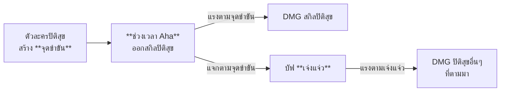

# สคริปต์: กลไกพาร์ทปิติสุข (Elation) & ช่วงเวลา Aha

> ฉบับนี้เขียนจากบทพูดจริง (ซับไตเติล `Research/Recording_Subtitles/4_complete.txt` ที่แก้คำศัพท์แล้ว) สคริปต์เดิมเก็บไว้ที่ `Elation_Mechanic_Script-Draft.md`

อีกไม่นาน **เทพดาราแห่งพาร์ทปิติสุขอย่าง Aha** ก็จะลงมาเป็นตัวละครให้เราได้เล่นกันในแพทช์ถัดไปแล้วนะครับ ก่อนที่ตัวละครอย่าง Aha จะมา ผมอยากจะพาทุกคนทบทวนกันหน่อยว่าพาร์ทปิติสุขมีเมคานิกอะไรพิเศษบ้าง ทั้ง **ช่วงเวลา Aha**, **จุดขำขัน**, **แต้มเจ๋งแจ๋ว** และสเตตัสใหม่อีกเพียบ มันทำงานยังไง คิดดาเมจแบบไหน คลิปนี้มีคำตอบครับ

สวัสดีครับผม **WAF** และวันนี้คุณอยู่กับคลิป **คู่มือปิติสุข 101** ครับ อย่างที่ได้พูดไปก่อนหน้านี้ คลิปนี้ทำขึ้นเพื่อ **ทวนพื้นฐานกลไกพาร์ทปิติสุข** ก่อนที่ในแพทช์ต่อไปเราจะได้พบกับตัวละครใหม่อย่าง Aha ครับ ส่วนรายละเอียดจะเป็นยังไงนั้นเชิญรับชมครับ

---

## 1. มีอะไรเปลี่ยนไปเมื่อมีตัวละครปิติสุขในทีม?

### จุดขำขัน (Punchline)

สำหรับผู้เล่นหลายๆ ท่านที่ได้ลองเล่นตัวละครหรือทีมปิติสุข ก็น่าจะสังเกตกันแล้วครับว่าเมื่อเราใส่ตัวละครปิติสุขเข้ามาในทีม บริเวณ **ขวาล่างใกล้ๆ กับ Skill Point** จะมี **รูปหน้ากาก** เด้งขึ้นมา สิ่งนี้เรียกว่า **จุดขำขัน**

* จุดขำขันคือ **แต้มพิเศษที่แชร์ร่วมกันทั้งทีม** ใครสร้างได้ก็เข้ากองกลางหมด
* เป็นสแต็กพิเศษที่ **มีแค่ตัวละครพาร์ทปิติสุขเท่านั้นที่สร้างได้**
* แต่ละตัวมี **เงื่อนไขการสร้างจุดขำขันต่างกันไป** บางตัวสร้างได้จากการกดสกิล บางตัวจากการกดท่าไม้ตาย หรืออาจได้จากการโจมตีของเพื่อนร่วมทีมก็ได้ครับ

### ช่วงเวลา Aha (Aha Instant)

ส่วนบริเวณ **ด้านซ้ายในแถบ Action Bar** ก็จะมี **เทิร์นแปลกๆ หน้าตาเหมือน Aha** เด้งขึ้นมาครับ ตรงนี้เราเรียกว่า **ช่วงเวลา Aha**

* ช่วงเวลา Aha จะเกิดขึ้นก็ต่อเมื่อ **ในทีมมีตัวละครปิติสุขอย่างน้อย 1 ตัว**
* หรือ **บัฟด่านในรอบนั้นๆ มีเมคานิกที่เกี่ยวข้องกับพาร์ทปิติสุข** ซึ่งแบบนี้ต่อให้ทีมเราไม่มีตัวละครปิติสุขเลย ช่วงเวลา Aha ก็โผล่มาได้ครับ

---

## 2. เมื่อถึงช่วงเวลา Aha จะเกิดอะไรขึ้น?

เมื่อวนมาถึงเทิร์นของ Aha จะเกิด **ช่วงเวลา Aha** ขึ้น ซึ่งจะ **ทริกเกอร์สกิลปิติสุขของตัวละครปิติสุขทุกตัวในทีม** โดยสกิลนี้ทำงานอัตโนมัติ ไม่ต้องกดเอง และไม่ใช่เทิร์นของตัวละครด้วยนะครับ

### ลำดับการออกสกิลปิติสุข

การทริกเกอร์สกิลปิติสุขตรงนี้มีลำดับการออกท่าอยู่ครับ โดยจะ **เรียงตามหมายเลขประจำตัวของตัวละครปิติสุข จากเลขน้อยไปเลขมาก** เช่น Pearl ที่มีเลข **104** ก็จะมาก่อน Yao Guang ที่มีเลข **116**

* ข้อดีของลำดับนี้คือ ทำให้เรารู้ว่าการโจมตีปิติสุขของตัวไหนจะได้บัฟจากตัวละครอะไรบ้าง
* เช่น Pearl ที่บัฟสกิลปิติสุขมีหมายเลข 104 ตัวละครที่หมายเลขมากกว่า Pearl ก็จะได้รับบัฟจากสกิลปิติสุขของ Pearl ด้วย
* กลับกัน ถ้ามีตัวละครที่หมายเลขประจำตัวต่ำกว่า Pearl ตัวนั้นก็จะไม่ได้รับบัฟจาก Pearl ครับ

โดยสกิลปิติสุขเหล่านี้จะ **แรงขึ้นตามจำนวนจุดขำขันที่ทีมมี** ยิ่งเก็บจุดขำขันมาเยอะเท่าไหร่ ช่วงเวลา Aha ก็จะยิ่งระเบิดดาเมจได้มากขึ้นเท่านั้นครับ

### ความถี่ของช่วงเวลา Aha

ความถี่ในการเกิดช่วงเวลา Aha จะขึ้นอยู่กับ **ความเร็วของตัวละครปิติสุขในทีมแบบเรียลไทม์** ครับ

* Aha มีความเร็วตั้งต้นอยู่ที่ **80**
* ตัวละครปิติสุขแต่ละตัวจะ **ส่งผลต่อความเร็วของ Aha ไม่เท่ากัน** โดยเรียงความสำคัญจากคนที่เร็วที่สุดในทีมไล่ลงไปดังนี้:
  * อันดับ 1 ให้ **20.0%** ของสปีดตัวเอง
  * อันดับ 2 ให้ **10.0%**
  * อันดับ 3 ให้ **5.0%**
  * อันดับ 4 ให้ **2.5%**
* เพราะเป็นแบบเรียลไทม์ ถ้าตัวละครปิติสุขในทีมได้บัฟสปีดระหว่างไฟต์ Aha ก็จะเร็วขึ้นตามทันทีครับ
* ถ้าอยากให้ Aha มีความเร็วประมาณ **160** แต่ละตัวต้องมีความเร็วประมาณ **213** ขึ้นไปถึงจะทำได้ ดังนั้นเราไม่ต้องไปซีเรียสกับเรื่องสปีดของ Aha มากหรอกนะครับ

### เมื่อช่วงเวลา Aha สิ้นสุดลง

* ตัวละครปิติสุขแต่ละตัวที่เข้าร่วมจะได้รับบัฟ **เจ๋งแจ๋ว (Certified Banger)** ตาม **จำนวนจุดขำขันที่ถูกใช้ไปในช่วงเวลา Aha** โดยบัฟนี้จะอยู่เป็นเทิร์น และแต่ละแต้มก็จะถูก **คำนวณเทิร์นแยกกัน**
* ส่วนจุดขำขันของทีมจะ **ถูกรีเซ็ต** และเริ่มนับใหม่ **ตามจำนวนตัวละครปิติสุขในทีม 1 แต้มต่อ 1 ตัว** ซึ่งตอนเริ่มไฟต์ครั้งแรกเราก็จะได้จุดขำขันตั้งต้นเท่ากับตอนรีเซ็ตด้วยครับ

---

## 3. แต้มเจ๋งแจ๋วใช้ทำอะไร?

มองแบบนี้แล้วกันนะครับ ถ้าจุดขำขันคือ **สแต็กกองกลางของทั้งทีม** แต้มเจ๋งแจ๋วก็เหมือน **จุดขำขันที่เก็บไว้ใช้ส่วนตัว** ของแต่ละตัวละคร โดยจะแสดงเป็นรูปหน้ากากใต้รูปตัวละครครับ

* สถานะนี้โดยพื้นฐานอยู่ได้ **2 เทิร์น** แต่ความสามารถของตัวละครบางตัว เช่น **Yao Guang** สามารถยืดระยะเวลาตรงนี้เพิ่มขึ้นได้
* เมื่อเริ่มเข้าไฟต์ ตัวละครปิติสุขทุกตัวจะได้รับแต้มเจ๋งแจ๋วฟรี **20 แต้ม** และแต่ละแต้มก็จะถูกนับเวลาแยกกันตามที่ได้กล่าวไปก่อนหน้านี้
* แต้มเจ๋งแจ๋วทำงานคล้ายๆ จุดขำขัน เพียงแต่ในขณะที่จุดขำขันช่วยเพิ่มดาเมจในช่วงเวลา Aha หรือสกิลปิติสุข แต้มเจ๋งแจ๋วจะช่วยเพิ่ม **DMG ปิติสุขอื่นๆ ที่ไม่ได้เกิดจากสกิลปิติสุข** เช่น ดาเมจปิติสุขที่เกิดจากพรสวรรค์
* **จุดสำคัญ:** พรสวรรค์ของตัวละครปิติสุขส่วนใหญ่จะ **ทำงานเฉพาะตอนที่มีแต้มเจ๋งแจ๋วเท่านั้น** เช่น ตีปกติหรือกดสกิลแล้วยิงดาเมจปิติสุขแถมออกมา ดังนั้นถ้าแต้มเจ๋งแจ๋วหมด พรสวรรค์ก็จะปิดตามไปด้วยครับ

---

## 4. DMG ปิติสุข และสเตตัสใหม่ที่ใช้คำนวณ

**DMG ปิติสุข (Elation DMG)** คือ **ดาเมจที่มีตัวเลขเป็นสีรุ้ง** ครับ เป็นดาเมจชนิดใหม่ที่มีการคำนวณแตกต่างจากดาเมจทั่วไปอยู่

### สูตรดาเมจปกติ

โดยปกติดาเมจทั่วไปจะคำนวณด้วย **ATK × ตัวคูณสกิล × ตัวคูณคริ × ตัวคูณโบนัสดาเมจ** ส่วนตัวคูณอื่นๆ ส่วนใหญ่เป็นตัวคูณที่มีกันในทุกดาเมจทุกประเภทอยู่แล้ว ดังนั้นจะขอไม่ขึ้นโชว์แล้วกันนะครับ

### สูตร DMG ปิติสุข

ส่วนดาเมจปิติสุขจะ **ไม่มีตัวคูณ ATK หรือตัวคูณ DEF** ครับ แต่จะอิงสเตตัสจาก **Level Multiplier** หรือ **ตัวคูณเลเวล** แทน

นอกจากนี้ก็จะ **ไม่มีตัวคูณโบนัสดาเมจ** ทำให้พวกลูกแก้วไฟ ลูกแก้วกายภาพ ไม่ค่อยมีประโยชน์กับตัวละครพาร์ทปิติสุข แต่ก็จะมีตัวคูณที่เพิ่มมาใหม่ ได้แก่ **ตัวคูณระดับปิติสุข**, **ตัวคูณจุดขำขัน (Punchline Multiplier)** และ **ตัวคูณเพิ่มเสียงหัวเราะ** ครับ

### ตัวคูณเลเวล (Level Multiplier)

สำหรับใครที่ไม่เคยได้ยินมาก่อน นี่เป็นตัวคูณที่ส่วนใหญ่ดาเมจเบรกจะใช้ครับ เป็นตัวคูณที่มีค่าคงที่ อิงตามเลเวลของตัวละครที่เป็นคนโจมตี

### ตัวคูณระดับปิติสุข

เป็นตัวคูณที่หาได้จากสกิลของตัวละครพาร์ทปิติสุข ซึ่งแต่ละตัวก็มีเงื่อนไขการได้รับแตกต่างกันไปครับ

### ตัวคูณจุดขำขัน (Punchline Multiplier)

ตัวคูณนี้มี 2 เรื่องที่แปลกจากตัวคูณอื่นนิดหน่อยครับ

* **เรื่องแรก:** ถ้าตัวคูณนี้ถูกคำนวณในช่วงเวลา Aha หรือจากการโจมตีของสกิลปิติสุข จะใช้ **จุดขำขัน** ในการคำนวณ แต่ถ้าเป็นกรณีอื่นนอกเหนือจากนั้น จะใช้ **แต้มเจ๋งแจ๋ว** แทน
* **เรื่องที่ 2:** ดาเมจที่เพิ่มต่อสเตตัสของตัวคูณนี้เป็นแบบ **Diminishing Return** ครับ เดี๋ยวผมขึ้นกราฟให้ดู
  * สเตตัสอื่นโดยทั่วไป ยิ่งเพิ่มมากเท่าไหร่ ดาเมจที่ได้เพิ่มก็จะเพิ่มขึ้นเป็นเส้นตรง
  * กลับกัน ตัวคูณจุดขำขันยิ่งเราเพิ่มเท่าไหร่ ดาเมจที่ได้เพิ่มต่อแต้มก็จะยิ่งลดลงเรื่อยๆ เราเรียกสิ่งนี้ว่า **Diminishing Return** ครับ

### เพิ่มเสียงหัวเราะ (Merrymake)

สเตตัสนี้ถ้าเอาง่ายๆ ก็คือ **สเตตัสหายากประจำทีมปิติสุข** นั่นแหละครับ เป็นสเตตัสที่มีไว้เพื่อการันตีว่า **E6 จะเพิ่มดาเมจให้คุณได้เยอะแน่นอน** ดังนั้นสเตตัสนี้ส่วนใหญ่ก็จะหาได้ใน **E6 ของตัวละครปิติสุข** เท่านั้นครับ

---

## 5. Conclusion

ก่อนจะไปต่อ ผมขอสรุปกลไกของทีมปิติสุขทั้งหมดให้เห็นเป็นภาพเดียวกันแบบนี้ครับ

เริ่มจากตัวละครทีมปิติสุข **สร้างจุดขำขัน** เมื่อถึง **ช่วงเวลา Aha** ทุกตัวจะออก **สกิลปิติสุข** ซึ่งจะทั้งสร้างความเสียหายและแจกบัฟ **เจ๋งแจ๋ว** โดยความแรงของทั้งสกิลปิติสุขและบัฟเจ๋งแจ๋วจะ **แปรผันตามจำนวนจุดขำขันที่เรามี** ยิ่งจุดขำขันเยอะก็ยิ่งแรง และยิ่งได้เจ๋งแจ๋วเยอะ **DMG ปิติสุขอื่นๆ ที่ตามมา** ก็จะยิ่งแรงตามไปด้วยครับ

---

## 6. Tip & Trick

### ทีมที่ไม่มีตัวละครปิติสุข

ถ้าบัฟด่านมีเมคานิกเกี่ยวกับปิติสุข ช่วงเวลา Aha ก็จะโผล่มาได้เหมือนกัน แม้ทีมเราจะไม่มีตัวละครปิติสุขอยู่เลย เพียงแต่ความสามารถจะทำงานต่างออกไปนิดหน่อย

* Aha จะใช้ท่า **สุ่มยิงดาเมจควอนตัม 10 ครั้ง** ใส่ทั้ง 2 ฝั่ง ทั้งฝั่งตรงข้ามและฝั่งเรา
* ฝั่งเราที่โดนยิงจะได้ฟื้นฟูพลังงานนิดหน่อย แต่ก็จะ **โดนดาเมจ 1 หน่วย** ด้วยนะครับ ถ้าตัวละครเหลือเลือด 1 ก็ตายได้เหมือนกัน
* ความเร็วของ Aha จะถูกคงที่ไว้ที่ **80**
* ดาเมจที่ศัตรูโดนจะ **คิดจากเลเวลของศัตรู** แทนเลเวลของตัวละคร และไม่มีแต้มเจ๋งแจ๋วมาเกี่ยวข้อง ใช้แค่จุดขำขันอย่างเดียว ตรงนี้ก็จะทำให้ดาเมจน้อยนิดหน่อยครับ

### ช่วงเวลา Aha นับเป็น Action และการโจมตี

* ช่วงเวลา Aha **นับว่าเป็น 1 Action** ดังนั้นการโจมตีในช่วงเวลา Aha ก็สามารถทริกเกอร์ความสามารถที่เกี่ยวข้องกับ Action ได้ เช่น ท่าไม้ตายของ **Dr. Ratio**
* ในทางกลับกัน ก็นับว่าเป็น **การโจมตี** ด้วย จึงทริกเกอร์ความสามารถที่เกี่ยวกับ "เมื่อโจมตี" ได้เช่นกัน อย่างท่าไม้ตายของ **Robin** หรือท่าไม้ตายของ **Tribbie** ครับ

### ดาเมจหลักไม่ได้มาจากช่วงเวลา Aha เสมอไป

* ถึงทีมปิติสุขจะดูเหมือนหมุนรอบช่วงเวลา Aha แต่ **ดาเมจหลักของทีมอาจไม่ได้มาจากช่วงเวลา Aha เสมอไป** นะครับ
* บางครั้งดาเมจจาก **ท่าไม้ตาย** หรือ **การโจมตีเสริมพลัง** ก็สำคัญกว่าสกิลปิติสุขซะอีก
* เพราะฉะนั้นอย่าโฟกัสแค่การเก็บจุดขำขันอย่างเดียว ต้องดูด้วยว่าตัวละครแต่ละตัวทำดาเมจหลักจากท่าไหนครับ

---

และนี่ก็คือทั้งหมดเกี่ยวกับ **คู่มือปิติสุข 101** ครับ พูดตามตรง ตอนแรกผมไม่ได้กะให้คลิปมีเนื้อหาเข้มข้นขนาดนี้เท่าไหร่ เพราะจุดประสงค์เดิมของคลิปนี้ คือผมแค่อยากลองทำคลิปให้ถี่ขึ้นเท่านั้นเองครับ

เพราะตอนนี้พูดตามตรงคือผมถึงทางตันแล้วครับ จะดันคุณภาพคลิปให้มากกว่านี้ก็คงไม่ไหว ที่เหลือก็คงต้องลงคลิปให้ถี่ขึ้นเท่านั้นแหละครับ ตอนแรกผมก็เลยไม่ได้กะจะลงเนื้อหาลึกอะไรมากมาย กะว่าให้คลิปนี้เป็นคลิปแรกของผมที่เบาสมองกว่าปกติ แต่สุดท้ายก็กลายเป็นว่าพาลงลึกอยู่ดีเนาะ แปลกใจตัวเองเหมือนกันว่าทำได้ไงวะ ขนาดพยายามเดินออกมาแล้วก็ยังเดินกลับเข้าไปอีก

สำหรับใครที่มีคำถามตรงไหน ก็คอมเมนต์สอบถามผมได้เหมือนเดิมเลยนะครับ ผมจะแวะเข้ามาตอบคอมเมนต์บ่อยๆ สำหรับวันนี้ผม **WAF** ขอตัวลาไปก่อน สวัสดีครับ
